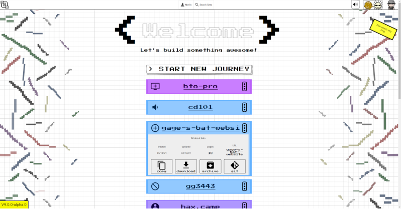

# HAX The Desktop
HAX The Desktop runs [haxcms-nodejs](https://github.com/haxtheweb/haxcms-nodejs) wrapped in Electron. Sites are stored in `_sites` in your home directory.



The app starts the real haxcms-nodejs server (`dist/app.js`) in no-login local mode. That mode only listens on `127.0.0.1` and refuses writes from other origins, so the desktop app needs a haxcms-nodejs release that includes those guards; it will refuse to start on an older one.

## How to run

```bash
npm install
npm start
```

## Testing against haxcms-nodejs main

CI tests against haxcms-nodejs `main`, not the last npm release. To do the same locally:

```bash
git clone https://github.com/haxtheweb/haxcms-nodejs.git ../haxcms-nodejs
(cd ../haxcms-nodejs && yarn install && npm run build)
rm -rf node_modules/@haxtheweb/haxcms-nodejs
ln -s ../../../haxcms-nodejs node_modules/@haxtheweb/haxcms-nodejs
npm test    # boots the server outside Electron and checks it end to end
npm start
```

## How to package for distribution

Packaging uses [Electron Forge](https://www.electronforge.io/) (`forge.config.js`). Each installer is built on its own operating system:

```bash
npm run package   # the packaged app, in out/
npm run make      # installers for the OS you are on, in out/make/
```

| Built on | Installers |
| --- | --- |
| Linux | `.deb`, `.zip` |
| Windows | Squirrel `Setup.exe` |
| macOS (Apple silicon and Intel) | `.dmg`, `.zip` |

The app ships as an asar archive with Electron fuses set, so the binary can't be run as plain Node, opened with `--inspect`, or pointed at different app code.

## Testing the packaged app

```bash
npm run package
npm run test:app   # Linux without a display: xvfb-run -a npm run test:app
```

`test/packaged-app.test.js` launches the packaged binary and checks the fuses, that the dashboard loads, that a site can be created and opened, that the page can't leave the local server, and that quitting stops the server.

CI (`.github/workflows/build.yml`) does this on Linux, Windows and both macOS architectures for every pull request, against haxcms-nodejs `main`. The installers from each run are attached to it as artifacts, so a change can be tried on a real machine before it is released.

## Releasing

See [docs/RELEASING.md](docs/RELEASING.md) for cutting a release and setting up code signing.
